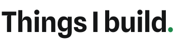
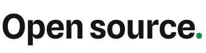

<!-- Generado por scripts/gen.mjs: edita el contenido ahí y corre `pnpm gen`. -->

<picture><source media="(prefers-color-scheme: dark)" srcset="assets/hero.dark.svg"></picture>

I build web apps with Next.js, Convex and TypeScript.

 

<picture><source media="(prefers-color-scheme: dark)" srcset="assets/things-i-build.dark.svg"></picture>

<a href="https://go.hugocastro.dev"><picture><source media="(prefers-color-scheme: dark)" srcset="assets/app-go.dark.svg"></picture></a>
<a href="https://postal.hugocastro.dev"><picture><source media="(prefers-color-scheme: dark)" srcset="assets/app-postal.dark.svg"></picture></a>
<a href="https://gather.hugocastro.dev"><picture><source media="(prefers-color-scheme: dark)" srcset="assets/app-gather.dark.svg"></picture></a>
<a href="https://interact.hugocastro.dev"><picture><source media="(prefers-color-scheme: dark)" srcset="assets/app-interact.dark.svg"></picture></a>
<a href="https://agenda.hugocastro.dev"><picture><source media="(prefers-color-scheme: dark)" srcset="assets/app-agenda.dark.svg"></picture></a>
<a href="https://me.hugocastro.dev"><picture><source media="(prefers-color-scheme: dark)" srcset="assets/app-me.dark.svg"></picture></a>

 

<picture><source media="(prefers-color-scheme: dark)" srcset="assets/open-source.dark.svg"></picture>

- **[round-robin-rmpe](https://github.com/HugoCL/round-robin-rmpe)**: round-robin pull request reviewer assignment for teams, with availability tracking and Google Chat notifications. [Demo](https://round-robin-rmpe-demo.vercel.app/)
- **[que-maldito-modelo-uso](https://github.com/HugoCL/que-maldito-modelo-uso)**: which AI model to use for coding, in three answers, from public benchmarks and real cost per task. [qmmu.hugocastro.dev](https://qmmu.hugocastro.dev)
- **[mlh-code-check](https://github.com/HugoCL/mlh-code-check)**: AI code review for GitHub repositories, driven by rubrics you define.
- **[mlh-fellowship-toolbox](https://github.com/HugoCL/mlh-fellowship-toolbox)**: operations cockpit for MLH Fellowship pod leaders.
- **[directorio-alumni-icc](https://github.com/HugoCL/directorio-alumni-icc)**: private directory connecting verified students and alumni.
- **[two-truths-one-lie](https://github.com/HugoCL/two-truths-one-lie)**: real-time multiplayer Two Truths and a Lie party game.

 

<picture><source media="(prefers-color-scheme: dark)" srcset="assets/lets-talk.dark.svg"></picture>

[hugocastro.dev](https://hugocastro.dev) · [LinkedIn](https://www.linkedin.com/in/hugocastrocl)

 

<a href="https://hugocastro.dev"><picture><source media="(prefers-color-scheme: dark)" srcset="assets/firma.dark.svg"></picture></a>
